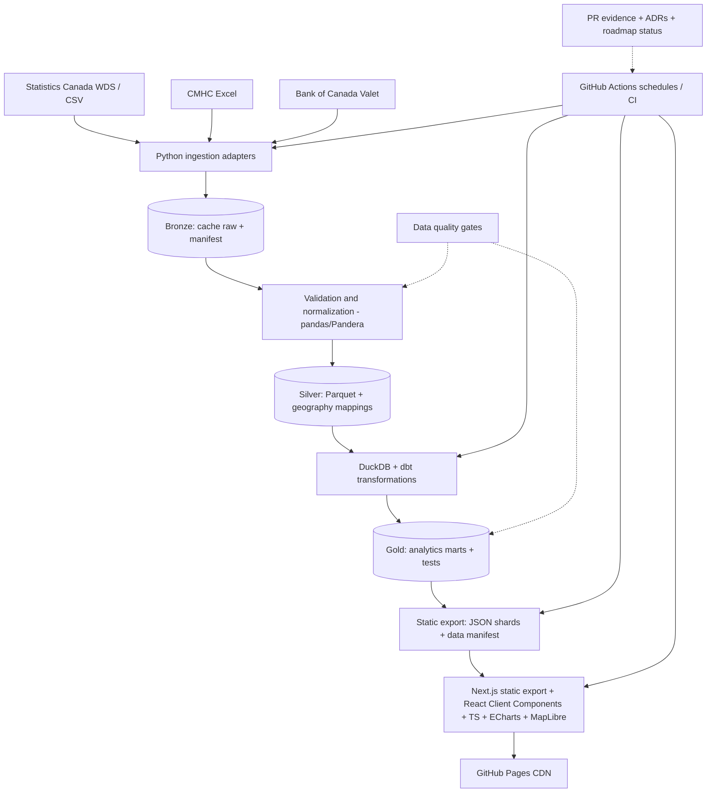

# CANADA AFFORDABILITY OBSERVATORY

## Master Project Roadmap & Engineering Reference

> **Codinome em revisão:** Northstar é provisório. A marca final será aprovada em `M00-T06` e registrada em ADR, sem renomear de antemão arquivos canônicos e links históricos.

> **Atualização M00-T06 (2026-10-26):** UrbanGauge foi aceito pelo mantenedor como nome deste repositório público de pesquisa, sem fins comerciais. O slug remoto `DevIsola/MetroLens` e este caminho canônico permanecem inalterados; disponibilidade de marca/domínio não foi comprovada. Consulte ADR-0003 para limites da decisão.

**Projeto:** Canada Affordability & Opportunity Observatory  
**Versão da especificação:** 0.2.0 — 26 de outubro de 2026  
**Status:** baseline proposta; nenhuma fase de engenharia foi validada como concluída  
**Idioma deste documento:** português (código, IDs e documentação pública poderão estar em inglês)  
**Fonte canônica:** `docs/NORTHSTAR_MASTER_ROADMAP.md` na branch padrão  
**Objetivo do documento:** especificação executável, roadmap versionado, trilha de decisões e base verificável do case study de portfólio.

> **Regra de confiabilidade:** funcionalidades, métricas de produção, datasets, SLAs e automações descritos aqui são **metas e decisões propostas**, não evidência de implementação. A palavra “concluído” só poderá ser usada após merge e critérios de aceite aprovados.

---

# 1. Resumo executivo e visão do produto

O produto (codinome de trabalho: Northstar) será um observatório de dados públicos canadenses que cruza indicadores de renda, trabalho, aluguel, vacância e economia para investigar acessibilidade habitacional entre regiões metropolitanas. O produto transforma dados heterogêneos em um dashboard público, bilíngue e responsivo, com narrativa editorial e um pipeline reproduzível que publica artefatos estáticos no GitHub Pages.

**Pergunta norteadora:** _Where can Canadians actually afford to live?_ — Onde o custo habitacional é mais ou menos compatível com a renda observada, considerando diferenças de período, definição e cobertura das fontes?

**Público-alvo:** recrutadores e gestores de Dados/Analytics, analistas de negócio, usuários interessados em custo de vida no Canadá e desenvolvedores que desejem estudar o código. **Valor para o portfólio:** provar a capacidade de entregar uma solução ponta a ponta que combina engenharia de dados, analytics engineering, BI, UX, QA, documentação e operação responsável.

## 1.0 Naming, posicionamento e decisão de marca

A expressão _Canada Affordability Observatory_ funciona como descriptor do produto, não como nome comercial. Manter `MetroLens` exclusivamente como codinome de implementação até que o mantenedor aprove uma identidade; não usar candidatas como se já estivessem registradas, disponíveis como domínio ou protegidas legalmente.

| Candidata               | Ideia / significado                                | Ponto forte                                                 | Cuidado                                                       |
| ----------------------- | -------------------------------------------------- | ----------------------------------------------------------- | ------------------------------------------------------------- |
| **CityMargin**          | A margem financeira restante após custos da cidade | Memorável, sugere cálculo e cenário de renda versus moradia | Pode soar como indicador de lucro e limitar expansão nacional |
| **UrbanGauge**          | _Gauge_ = instrumento para medir condições urbanas | Forte fit com dashboard e dados                             | "Urban" cobre mal áreas rurais; verificar colisões            |
| **Living Ledger**       | Livro-razão público do custo de vida               | Transparência, rastreabilidade e dados auditáveis           | Nome mais editorial que geográfico                            |
| **MetroLens**           | Lente que permite examinar regiões metropolitanas  | Comunicação visual, exploração e mapas                      | Expansão para províncias exigirá posicionamento mais amplo    |
| **Place & Pay**         | Relação entre lugar, salário e despesas            | Fácil de lembrar; narrativo e acessível                     | Pode ser associado a meios de pagamento                       |
| **Affordability Atlas** | Atlas comparativo da acessibilidade habitacional   | Descreve imediatamente o conteúdo e ajuda descoberta        | Menor diferenciação e maior risco de uso genérico             |
| **Civic Ledger**        | Dados de interesse público registrados com método  | Credibilidade e auditabilidade; suporta novas categorias    | Pode passar impressão de órgão governamental                  |

**Shortlist editorial proposta:** `CityMargin` (marca mais distintiva), `UrbanGauge` (mais analítica) e `Living Ledger` (melhor relação com transparência). Recomendação inicial: **CityMargin**, condicionada a checagens de conflito, preferência do mantenedor e possibilidade de comunicação bilíngue. Isto **não** é decisão final nem verificação de disponibilidade jurídica/domínios/usuários.

**Atualização de decisão (2026-10-26):** O mantenedor indicou **UrbanGauge** como preferência preliminar. Uma pesquisa web adicional encontrou uso histórico do nome em um projeto de indicadores urbanos, além de UrbanGauge Studio e um anúncio premium de `urbangauge.com`. A preferência **não aprova** marca, domínio, renomeação ou publicação. A ADR-0003 mantém o gate de investigação e aceite final.

**Critérios objetivos M00-T06:** pesquisar GitHub, domínios `.com`/`.ca`, lojas de apps, buscas e marcas registradas; avaliar pronúncia em inglês/PT-BR, leitura sem contexto, escalabilidade de marca, legibilidade em mobile, distintividade e cobertura do escopo (cidade × província); registrar alternativas rejeitadas e ADR de decisão. A atualização do nome deverá modificar README, metadata, título, asset manifest, textos de UI e caminhos de docs com redirecionamento/compatibilidade de links históricos quando necessário.

## 1.1 Outcomes e não objetivos

| Dimensão   | Resultado esperado                                                         | Não objetivo no MVP                                |
| ---------- | -------------------------------------------------------------------------- | -------------------------------------------------- |
| Produto    | Dashboard navegável com comparações confiáveis e conclusão contextualizada | Plataforma comercial, autenticação ou marketplace  |
| Dados      | Pipeline batch versionável, auditável e incremental quando fizer sentido   | Streaming em tempo real e big data fictício        |
| Engenharia | Arquitetura modular, testes, custos mínimos, deploy repetível              | Kubernetes, Kafka ou microserviços sem necessidade |
| UX         | EN + PT-BR, acessibilidade, mobile, narrativa clara e fontes visíveis      | Gráficos ornamentais sem decisão de negócio        |
| Portfólio  | Código, ADRs, metodologia, evidências, demonstração e aprendizado          | Afirmações de performance sem medição              |

## 1.2 Hipóteses analíticas iniciais

H1 — O crescimento dos aluguéis foi diferente do crescimento da renda em determinadas regiões e intervalos comparáveis.  
H2 — A relação entre vacância e aluguel varia por região; uma correlação não prova causalidade.  
H3 — A acessibilidade percebida muda significativamente conforme tipo de moradia, renda utilizada e período estatístico.  
H4 — O conjunto de dados disponível contém lacunas e definições que precisam ser explicitadas para comparar cidades de modo justo.

A validação das hipóteses exige exploração e cobertura compatível dos dados, não resultados predefinidos.

## 1.3 Indicadores iniciais e fórmulas

| Indicador            | Fórmula / semântica                                                | Ressalva                                                                    |
| -------------------- | ------------------------------------------------------------------ | --------------------------------------------------------------------------- |
| Rent-to-income ratio | `monthly_rent * 12 / annual_household_income * 100`                | Comparar mesmo recorte geográfico/período; declarar renda bruta vs. líquida |
| Rent change YoY      | `(rent_t / rent_t_minus_1 - 1) * 100`                              | Mesmo segmento de imóvel e metodologia de pesquisa                          |
| Income change YoY    | `(income_t / income_t_minus_1 - 1) * 100`                          | Mesma definição de renda; conferir inflação                                 |
| Rent-income gap      | `rent_yoy_pct - income_yoy_pct`                                    | Diferença em pontos percentuais, não causa econômica                        |
| Vacancy rate         | Indicador original da CMHC                                         | Pesquisa e universo cobertos precisam ser descritos                         |
| Reference freshness  | `publication_timestamp`, `reference_period`, `ingestion_timestamp` | Não confundir “processado hoje” com “dado de hoje”                          |

**Semântica obrigatória:** aluguéis de contratos existentes, preços anunciados, aluguel de unidades ocupadas, valores médios e medianos não são intercambiáveis. O MVP utilizará apenas conceitos que possam ser documentados e ligados a fontes específicas; não será calculado um “índice universal de affordability” arbitrário.

# 2. Fontes oficiais, licenciamento e governança

| Fonte                                          | Papel / possibilidade                                  | Interface proposta                           | Cadência efetiva                                        |
| ---------------------------------------------- | ------------------------------------------------------ | -------------------------------------------- | ------------------------------------------------------- |
| Statistics Canada                              | Renda, emprego, preços e indicadores sociodemográficos | WDS API, CSV de tabelas e metadados          | Por tabela e série; validar antes de agendar            |
| Canada Mortgage and Housing Corporation (CMHC) | Aluguéis, taxas de vacância, tamanho do mercado        | Tabelas Excel da Rental Market Survey        | Conforme edição divulgada; não supor atualização diária |
| Bank of Canada                                 | Taxa de juros e séries macroeconômicas                 | Valet API sem chave                          | Conforme série publicada                                |
| Geo boundaries oficiais (opcional)             | Mapas de CMA e províncias                              | GeoJSON/TopJSON com fonte/licença verificada | Atualizar apenas quando necessário                      |

**Processo de descoberta de dados (bloqueante para M02):** registrar URL da tabela, identificador da série/tabela, publisher, tipo de métrica, unidade, geografia, intervalo temporal, granularidade, limitação de comparação, frequência, termos de uso, copyright/atribuição e estratégia de atualização. **Não inserir IDs de tabelas hipotéticos no código**: eles serão definidos após exame das fontes e amostras.

**Política de licenciamento:** confirmar termos para reprodução, cache e redistribuição de cada dataset; preservar atribuição e link para a página oficial. Não redistribuir arquivos brutos se os termos impedirem isso. Não utilizar dados pessoais nem introduzir tracking intrusivo.

## 2.1 Política de qualidade e integridade

- Retenção de proveniência (`source_id`, `source_url`, `retrieved_at`, `reference_period`, `source_version`, `sha256`).
- Checagem de esquema, tipo, unidade, enum de geografia, unicidade por chave natural, intervalos plausíveis e nulidade contextual.
- Distinguir `missing`, `suppressed`, `not_applicable` e `not_published` sempre que fornecidos pela fonte.
- Quando faltar uma dimensão necessária, exibir indisponibilidade em vez de combinar dados incompatíveis silenciosamente.
- Mudanças de definição, regiões/metodologias e revisões históricas devem gerar um evento de documentação e, se necessário, um ADR.
- Comparações com geografia e frequência diferentes requerem uma tabela explícita de compatibilidade e regra de agregação.

# 3. Stack e decisões tecnológicas

| Camada                      | Escolha                                                         | Motivação técnica                                                                                  | Introdução |
| --------------------------- | --------------------------------------------------------------- | -------------------------------------------------------------------------------------------------- | ---------- |
| Linguagem de dados          | Python 3.x (versão fixa após teste de compatibilidade)          | Ecossistema e clareza                                                                              | M01        |
| Dependências Python         | `uv` + `pyproject.toml` + lockfile                              | Reprodutibilidade e desempenho de instalação                                                       | M01        |
| Ingestão HTTP               | `httpx` com timeouts/retry/backoff                              | Clientes tipados, tratamento de erros                                                              | M02        |
| DataFrames                  | `pandas`, `numpy`                                               | EDA e transformações heterogêneas                                                                  | M02–M03    |
| Formato intermediário       | Parquet + `pyarrow`                                             | Compressão, colunares, portabilidade                                                               | M03        |
| Motor analítico             | DuckDB (embedded)                                               | SQL eficiente sem serviço pago                                                                     | M03–M04    |
| Transformações declarativas | dbt + adaptador DuckDB compatível                               | Modelagem, lineage, testes, documentação                                                           | M04        |
| Validação                   | Pandera + pytest + dbt tests                                    | Contratos em Python e SQL                                                                          | M02–M04    |
| EDA                         | Jupyter, matplotlib, seaborn, scipy opcional                    | Notebooks reproduzíveis, análise estatística                                                       | M08        |
| Frontend                    | **Next.js (App Router) + React + TypeScript (strict)**          | Rotas estáticas pré-renderizadas, Server Components de build e ilhas interativas Client Components | M01, M05   |
| Estilo                      | Tailwind CSS + shadcn/ui + CSS variables semânticas             | Sistema visual Taiwan Metrics–inspired em light/dark, acessível e responsivo                       | M05        |
| Gráficos                    | Apache ECharts, com alternativas tabulares                      | Visualização avançada responsiva                                                                   | M05–M06    |
| Mapas                       | MapLibre GL JS + geometrias oficiais otimizadas                 | Mapa interativo sem lock-in de SDK                                                                 | M06        |
| Estado / fetch              | TanStack Query + URLSearchParams; Zustand se necessário         | Cache e filtros reproduzíveis                                                                      | M05–M06    |
| Internacionalização         | i18next + react-i18next + Intl + rotas geradas `/en` e `/pt-br` | Idiomas explícitos no URL, SEO estático sem middleware                                             | M05        |
| Testes UI                   | Vitest + Testing Library + Playwright                           | Unitário, integração e E2E                                                                         | M05–M11    |
| Automação                   | GitHub Actions + `next build` / export estático                 | CI, ETL agendado, deploy de `out/` no Pages                                                        | M01, M09   |
| Hospedagem                  | GitHub Pages                                                    | Gratuito e estático                                                                                | M05        |
| Qualidade/segurança         | Ruff, mypy quando viável, ESLint, tsc, Dependabot               | Padrões e dependency hygiene                                                                       | M01, M11   |
| BI complementar             | Power BI (opcional)                                             | Demonstração de BI corporativo                                                                     | B01        |

**Compatibilidade:** versões exatas serão pinadas em lockfiles no milestone M01 e revisadas durante instalação; não fixar versões presumidas neste baseline. Particularmente dbt/adaptadores e bibliotecas de frontend devem ser avaliados por versão estável e suporte no momento da implementação.

## 3.1 Decisões explícitas de escopo

- **Sem API de aplicação no MVP.** Toda transformação pesada ocorre no pipeline de build/batch. O browser recebe agregados JSON versionados.
- **Sem bancos remotos obrigatórios.** DuckDB funciona como motor offline do pipeline; não se expõe `.duckdb` diretamente no frontend.
- **Parquet para transformação, JSON para distribuição seletiva.** Browser não baixa o lake inteiro.
- **Sem “dados em tempo real”.** O painel mostra periodicidade e último período oficial disponível.
- **Monorrepositório simples.** Uma só fonte de código com `/frontend` (**Next.js App Router**), `/pipeline` e `/docs`. Não criar package sharing complexo no começo.
- **Use bibliotecas maduras com justificativa.** Nenhuma infraestrutura distribuída será introduzida apenas como buzzword.

## 3.2 Estratégia Next.js + React: decisão e limites de execução

**Next.js é um framework sobre React; não existe redundância em usar os dois.** Adotar App Router com TypeScript `strict`, estrutura de Server Components para shell e conteúdo estático no momento do build e Client Components somente para filtros, visualizações, simuladores, menus e persistência local. Empregar `dynamic import` para ECharts/MapLibre quando apropriado.

**Deployment obrigatório no MVP:** `output: 'export'`, `trailingSlash: true`, exportação para `out/` e `images.unoptimized: true` (ou image loader remoto revisado). Não usar recursos Next.js que exigem runtime de servidor: **SSR por requisição, Server Actions, ISR, Route Handlers dinâmicos, API endpoints, cookies/headers da requisição, rewrites, redirects ou middleware/proxy**. Um Route Handler só é aceitável quando renderizado estaticamente no build e realmente necessário; para datasets, preferir arquivos em `public/data` gerados pelo pipeline.

**GitHub Pages project site:** definir `NEXT_PUBLIC_BASE_PATH` em build para `/<repo-name>` (vazio em domínio próprio ou root site). Reutilizar a mesma variável em `next.config.ts` (`basePath`) e no helper `dataUrl()`. Configurar `trailingSlash: true` e verificar navegação direta em `/en/`, `/pt-br/`, `/en/explore/`, páginas editoriais e URLs com query strings. `assetPrefix` é opcional e não substitui o `basePath` de navegação; não aplicar duplicação de prefixo. Não presumir que deploy em subpath funcione apenas por ter passado no localhost.

```ts
// frontend/next.config.ts — exemplo de contrato; a configuração efetiva será validada em M01
import type { NextConfig } from "next";
const basePath = process.env.NEXT_PUBLIC_BASE_PATH ?? "";
const nextConfig: NextConfig = {
  output: "export",
  basePath,
  trailingSlash: true,
  images: { unoptimized: true },
};
export default nextConfig;

// Helper para JSONs servidos de /public/data (não usar fetch('/data/...') em project pages)
export const dataUrl = (file: string) =>
  `${process.env.NEXT_PUBLIC_BASE_PATH ?? ""}/data/${file.replace(/^\/+/, "")}`;
```

**i18n estático:** `/` será uma landing estática com seleção/links de idioma, sem redirect de servidor. Usar `app/[locale]/...` + `generateStaticParams()` para `en` e `pt-br`, incluir caminhos de todas as histórias publicadas durante o build. Não usar `i18n` integrado a `next.config` nem roteamento dependente de middleware no export estático. Alteração de idioma troca de rota mantendo visualização e parâmetros de filtro; chaves e dados devem ser preservados. Strings estáticas traduzíveis poderão ser carregadas no build, enquanto mensagens de controles interativos usam i18next no cliente.

**Estratégia de atualização de dados:** a execução automatizada atualiza JSONs versionados, valida contratos e dispara `next build` para recriar HTML e `out/`. Não há atualização server-side contínua: a observação muda depois de publicar novo artefato. O frontend deve mostrar `reference_period`, `published_at`, `generated_at`, `sha` de release e estado de frescor.

**Arquitetura de componentes:** preferir Server Component para composição imutável; `'use client'` no limite mínimo de interação; TanStack Query somente onde cache e invalidação agregam valor, caso contrário fetch estático com hook pequeno. `next/image` sem otimizador remoto por padrão; mapas e charts são carregados apenas nas páginas que os necessitam. SSR/Server Actions ficam como possíveis migrações futuras, mediante ADR e hospedagem compatível.

**Justificativa versus React + Vite puro:** Vite isolado é mais simples para uma SPA; entretanto, rotas HTML geradas, estrutura de produto e portfolio/case study com metadados por página justificam Next.js, desde que a complexidade do static export seja explicitamente testada.

# 4. Arquitetura end-to-end



## 4.1 Data flow, estados e fallback

1. **Discover:** catálogo com disponibilidade, licença, granularidade, schema sample e data de publicação.
2. **Extract:** coletar por fonte com timeout, retry limitado, validação de resposta, checksum e cache idempotente.
3. **Bronze:** guardar arquivo de origem permitido e um manifest imutável por ingestão; não commitar binários grandes no repositório.
4. **Silver:** padronizar tipos, unidade, região, periodicidade e sinalizadores de missing/suppression; particionar por fonte/período quando pertinente.
5. **Gold:** gerar métricas documentadas e marts por caso de uso; executar testes de validade e reconciliação.
6. **Export:** gerar manifest com `schema_version`, `dataset_version`, `generated_at`, `sources` e arquivos JSON; tamanhos limitados e hash.
7. **Consume:** Next.js pré-renderiza HTML/metadata/rotas; Client Components React fazem fetch apenas dos shards necessários, tratam erro/empty state/stale e usam locale sem depender de backend.
8. **Publish:** CI somente promove artefatos após testes; falha conserva o último deploy bom, não publica dados possivelmente incorretos.

**Atenção ao armazenamento:** GitHub Actions é efêmero. Cache e histórico de raw data precisam de estratégia explícita: descarte/reingestão para arquivos pequenos, artifacts temporários para diagnóstico e persistência externa opcional no futuro. Não assumir que um runner retém arquivos entre execuções. O site publicado serve os agregados como assets versionados, não como armazenamento operacional do lake.

## 4.2 Contratos principais

**Região:** `region_id` interno estável; `source_geo_code`; `geo_type` (`CMA`, `province` etc.); `display_name_en`, `display_name_pt`; `valid_from`, `valid_to` quando aplicável. Mapeamento explícito de versões de limites geográficos.

**Observação:** `metric_id`, `region_id`, `reference_period`, `periodicity`, `value`, `unit`, `measure_type`, `source_id`, `quality_flag`, `published_at`, `retrieved_at`, `transformation_version`. Unicidade composta de chaves sem duplicação semântica.

**Gold / visualização:** `dashboard_overview.json`, `cities/<region_id>.json`, `comparisons/<metric_id>.json`, `geo/regions.topo.json`, `data-manifest.json` (nomes ilustrativos; contrato estabilizado em M04). Exportar apenas campos utilizados na interface.

**SLA/SLO aspiracionais:** taxa de sucesso de CI >= 95% no período observado após estabilização; 0 testes críticos ignorados; falha de fonte externa nunca publica dataset vazio; data timestamp visível em toda tela analítica; metas de Core Web Vitals definidas e medidas em M11, sem afirmar conformidade antecipadamente.

# 5. UX/UI, acessibilidade e storytelling

## 5.1 Direção visual — referência Taiwan Metrics, interpretação própria

**Referência:** https://www.taiwanmetrics.com/ (verificada em 2026-10-26). Inspirar-se na **linguagem e hierarquia**, não copiar marca, gráficos, código-fonte, textos ou ilustrações. A referência apresenta hero tipográfico, fundo escuro quase preto, tom coral/vermelho como foco, mini-labels em caixa alta, KPIs com variação temporal, cartões de baixo relevo e coleção de gráficos exploráveis por assunto. **Aplicação no produto:** mesma composição editorial-first, porém com nossa identidade autoral e informações canadenses comprovadas; não usar números da referência como dado do projeto.

**Conceito:** _Editorial Economic Intelligence_. Interface que abre com uma afirmação investigável e guia o visitante por indicadores, perguntas e evidências. O fundo escuro transmite precisão, o coral serve para navegação/ações e o uso generoso de espaço negativo evita aparência de BI corporativo excessivamente denso.

### Dark (tema de destaque, inspirado em Taiwan Metrics)

| Token                     | Valor proposto | Utilização                                   |
| ------------------------- | -------------- | -------------------------------------------- |
| `--color-canvas`          | `#0D0F12`      | Fundo principal, quase preto                 |
| `--color-surface`         | `#181B20`      | Cards e controles                            |
| `--color-surface-raised`  | `#22262C`      | Hover/sobreposição                           |
| `--color-text`            | `#F5F6F7`      | Conteúdo principal                           |
| `--color-text-muted`      | `#ADB3BC`      | Legendas e notas                             |
| `--color-accent`          | `#F46D5F`      | Foco editorial e CTA (texto em fundo escuro) |
| `--color-accent-contrast` | `#131518`      | Texto em CTA coral                           |
| `--color-border`          | `#333840`      | Delimitação suave                            |
| `--color-positive`        | `#68CDA5`      | Resultado favorável (com texto e ícone)      |
| `--color-negative`        | `#F28A88`      | Resultado desfavorável (com texto e ícone)   |

### Light (criação própria, mesma gramática visual)

| Token                     | Valor proposto | Utilização                              |
| ------------------------- | -------------- | --------------------------------------- |
| `--color-canvas`          | `#F7F7F5`      | Fundo off-white neutro                  |
| `--color-surface`         | `#FFFFFF`      | Cards nítidos                           |
| `--color-surface-raised`  | `#F0F1F0`      | Hover/sobreposição                      |
| `--color-text`            | `#202328`      | Tipografia principal                    |
| `--color-text-muted`      | `#606773`      | Legendas e notas                        |
| `--color-accent`          | `#BC453B`      | Links, labels e acentos                 |
| `--color-accent-contrast` | `#FFFFFF`      | Texto em CTA coral                      |
| `--color-border`          | `#DDE0DF`      | Separações sutis                        |
| `--color-positive`        | `#126C55`      | Resultado favorável com ícone/rótulo    |
| `--color-negative`        | `#B03D3D`      | Resultado desfavorável com ícone/rótulo |

**Tokens implementáveis:** `docs/design/taiwan-metrics-inspired.tokens.json` + `docs/design/theme-reference.css` são especificações iniciais reutilizáveis; M05 valida contraste real e refina somente via ADR/token versioning. Outras cores de séries (`series-1..6`), foco, grid e seleção têm valores em tokens; não hardcodar cores dentro de gráficos. Os números são **propostas de design**, não amostragem exata do CSS do site original.

### Tipografia, composição e gráficos

- **Tipografia:** títulos grandes e compactos com peso 650–750 e tracking levemente negativo; corpo 15–16 px, números com `font-variant-numeric: tabular-nums`; uso de `Inter` ou sans variável com fallback de sistema, mediante análise de licença/performance.
- **Top bar:** wordmark compacto + logo geometrizado, navegação Overview / Explore / Lab / Stories, botões EN / PT-BR e ícone de tema visíveis em qualquer viewport. No mobile, menu acessível com destinos não ocultos permanentemente.
- **Hero:** eyebrow `DATA-DRIVEN INSIGHTS`, afirmação analítica sem exageros, frase de contexto, CTA principal para explorar e data do período oficial. Fundo com padrão geométrico de pontos _original_, estático e de baixíssimo peso (evitar animação gratuita).
- **KPI strip:** 3–4 cards com valor, unidade, delta, período e fonte; não usar verde/vermelho isolados nem setas que prejulguem evolução de aluguel como positiva/negativa.
- **Explorer:** filtros/chips à vista, grid de gráficos de duas colunas em desktop e uma em mobile; cada card tem título, insight curto, série, legenda, descrição e fonte. Componentes são responsivos e não achatam labels críticos.
- **Charts:** ECharts com cores semânticas, grid discreta, tooltip com período/unidade/fonte, highlight por foco, alternativa tabular e experiência reduzida de movimento. Diferenciação por forma/padrão quando necessário para daltonismo.
- **Story cards:** cards editoriais com pergunta e takeaway verificável; clicar abre narrativa com visualização contextual, evidências e limitações.
- **Breakpoints iniciais:** 360/390 px, 768 px, 1024 px, 1440 px; ajustes por conteúdo e container queries quando necessários.
- **Theme UX:** `system` como preferência inicial, `light`/`dark` manual persistente, sem flash significativo, estado do seletor com anúncio acessível e testes em ambos os temas.
- **Acessibilidade:** contrastes medidos por papel de token e tamanho de texto; WCAG 2.2 AA como alvo; zoom 200%/400%, teclado, focus-visible, lista de dados alternativa a mapas, não depender apenas de cores.

### Descrição dos mockups de referência a criar no milestone M05

1. **Landing hero (desktop 1440):** cabeçalho horizontal, hero duas colunas (headline e padrão geométrico), 4 métricas, filtro por assunto e primeiro conjunto de gráficos. **Objetivo:** causar impacto imediato e estabelecer autoridade sem exigir login.
2. **Explorer (desktop 1280):** trilho compacto de filtros, grid charts 2×N, visualização geográfica secundária, cards com datas e fontes. **Objetivo:** exploração densa, mas sem sobrecarregar leitura.
3. **Mobile 390:** título em 2–3 linhas, KPIs roláveis por foco/scroll, filtros em drawer acessível e cards empilhados. **Objetivo:** manter interação completa em largura pequena.
4. **Theme pair:** mesmas telas e dados em light/dark lado a lado, com checagem de contraste, estados e semântica de cor. **Objetivo:** provar equivalência funcional e visual.

**Referências complementares:** Taiwan Metrics (ritmo editorial/cards), Our World in Data (fontes/metodologia), Observable (interatividade analítica) e W3C WCAG 2.2 (testes de acessibilidade). Nenhum deles deve ser clonado visualmente; o case study explicará claramente inspiração versus trabalho original.

## 5.2 Arquitetura de informação

| Rota (proposta)          | Propósito                                                                               | Primeira entrega |
| ------------------------ | --------------------------------------------------------------------------------------- | ---------------- |
| `/`                      | Entrada estática com links explícitos para `/en/` e `/pt-br/`; sem redirect de servidor | M05              |
| `/en/`, `/pt-br/`        | Executive Overview: principais tendências, KPIs, insight e fonte                        | M05              |
| `/{locale}/explore/`     | City Explorer: selecionar, filtrar, mapear, comparar                                    | M06              |
| `/{locale}/lab/`         | Affordability Lab: cálculo de cenários e premissas                                      | M07              |
| `/{locale}/stories/`     | Stories: narrativas analíticas versionadas; slugs pré-gerados                           | M08              |
| `/{locale}/methodology/` | Dados, licenças, fórmulas e limitações                                                  | M05/M10          |
| `/{locale}/data-status/` | Frescor dos dados, pipeline, changelog analítico                                        | M10              |

GitHub Pages é um host estático: gerar **cada rota com Next.js App Router e `generateStaticParams()`**, exportar com `trailingSlash: true` e verificar abertura direta em qualquer subrota publicada. Não recorrer a hash router/404 SPA fallback como arquitetura padrão. Configurar `basePath`/`NEXT_PUBLIC_BASE_PATH` no build de acordo com o nome do repositório ou domínio personalizado.

## 5.3 Internacionalização integral

Língua padrão: inglês (`/en/`); alternativa: português brasileiro (`/pt-br/`). Gerar ambos os idiomas como rotas estáticas via `app/[locale]/...`, sem middleware/`next.config.i18n`. Traduzir UI, tooltip, rótulos de eixo, metodologias, narrativas, metadados SEO e estados de erro/vazio. Separar keys `common`, `overview`, `explore`, `lab`, `methodology`, `stories`. Traduzir conteúdo editorial por registro e verificar cobertura em CI. Trocar locale mantendo nome da rota e filtros; persistir preferência sem sobrescrever locale explicitado na URL. Formatar datas/moeda/unidades com `Intl`, preservando valores numéricos brutos.

**Acessibilidade:** navegação por teclado, foco visível, `aria-label` em controles, tabela de dados como alternativa ao gráfico, legendas textuais, tooltip acessível, reduzido movimento, estados claros e viewport móvel. Interfaces de comparação devem aceitar dois ou mais filtros sem exigir precisão de mouse.

## 5.4 Regras editoriais de storytelling

Cada Insight terá `id`, pergunta, período, definição de métrica, evidência, visualização, comparação, ressalvas, conclusão, revisão e fonte. Toda afirmação deve estar ligada a consulta reproduzível (`query_id` / notebook). Não usar causalidade em resultado apenas correlacional. Alertar sobre diferenças entre aluguel médio observado e aluguel anunciado para nova locação. A interface mostrará um estado 'insufficient comparable data' quando as séries não tiverem alinhamento adequado.

# 6. Organização do repositório

```text
<repo-slug-a-definir>/                 # Northstar continua apenas como codinome
├── README.md                         # Vitrine e quick start
├── pyproject.toml                    # Python / uv
├── uv.lock
├── package.json / pnpm-lock.yaml     # Frontend: workspace simples, se adotado
├── frontend/
│   ├── next.config.ts                # output export, basePath e trailingSlash
│   ├── src/app/[locale]/{page.tsx,explore/,lab/,stories/,methodology/}
│   ├── src/app/[locale]/layout.tsx  # generateStaticParams para en e pt-br
│   ├── src/components/{layout,charts,filters,ui}/
│   ├── src/features/{overview,explore,lab,stories}/
│   ├── src/i18n/locales/{en,pt-BR}/
│   ├── src/styles/{tokens.css,globals.css}/    # semântica dark/light
│   ├── src/lib/{data-url,formatting,metrics}/
│   ├── public/data/                  # Somente resultados aprovados do pipeline
│   └── tests/
├── pipeline/
│   ├── src/northstar/{ingestion,validation,transform,export,observability}/
│   ├── dbt/{models,macros,seeds,tests}/
│   ├── notebooks/                    # EDA; não fonte das transformações de prod
│   ├── tests/{unit,integration,contract}/
│   └── data/{raw,bronze,silver,gold}/  # gitignored (salvo pequenas fixtures)
├── docs/
│   ├── NORTHSTAR_MASTER_ROADMAP.md   # Caminho canônico legado até decisão M00-T06
│   ├── roadmap-status.json           # Status estruturado + referências de evidências
│   ├── CHANGELOG.md                  # Evolução humana validada por release/PR
│   ├── DATA_CATALOG.md
│   ├── METRICS_DICTIONARY.md
│   ├── METHODOLOGY.md
│   ├── PORTFOLIO_CASE_STUDY.md
│   ├── design/{taiwan-metrics-inspired.tokens.json,theme-reference.css}/
│   ├── adr/                           # Architecture Decision Records
│   └── generated/                     # Saídas derivadas, não editadas manualmente
├── scripts/{sync_roadmap.py,verify_docs.py}
├── .github/
│   ├── ISSUE_TEMPLATE/
│   ├── PULL_REQUEST_TEMPLATE.md
│   └── workflows/{ci.yml,data-refresh.yml,pages.yml}
└── .gitignore
```

**Separação de responsabilidades:** bibliotecas de ingestão não conhecem Next.js/React; métricas gold são computadas no pipeline; frontend apenas calcula indicadores de cenário a partir de fórmulas transparentes. Notebooks exploratórios não alimentam produção sem transformação formal e testes. Conteúdo editorial tem dados/proveniência versionados.

# 7. Roadmap de engenharia — rastreável por milestone

## 7.1 Estratégia de execução e gestão

- IDs estáveis: `M00` a `M11`, entregas internas `Mnn-Txx`, e extras `B01` em backlog. Não renumerar IDs após merges.
- Status válidos: `not_started`, `in_progress`, `blocked`, `done`. `done` requer evidências reais no GitHub.
- Cada tarefa vira Issue e PR vinculado (`Closes #...`), com docs impact, testes e demonstração verificável.
- Dependências tratadas explicitamente. Um milestone pode ter tarefas em paralelo somente quando seus contratos já estiverem acordados.
- Nenhuma estimativa de prazo rígido até estimar volume, fontes e disponibilidade do desenvolvedor; priorização é por dependência e valor.

<!-- ROADMAP_STATUS_START -->
<!-- This section is generated by scripts/sync_roadmap.py. Do not edit manually. -->

| Milestone | Escopo                              | Status       | Evidência |
| --------- | ----------------------------------- | ------------ | --------- |
| M00       | Discovery e contrato do produto     | Em andamento | Pendente  |
| M01       | Foundation + CI + governança        | Não iniciado | Pendente  |
| M02       | Ingestão das fontes oficiais        | Não iniciado | Pendente  |
| M03       | Bronze / Silver + qualidade         | Não iniciado | Pendente  |
| M04       | Gold marts + dbt + export           | Não iniciado | Pendente  |
| M05       | Design system, i18n e Overview      | Não iniciado | Pendente  |
| M06       | City Explorer + mapas               | Não iniciado | Pendente  |
| M07       | Affordability Lab                   | Não iniciado | Pendente  |
| M08       | Insights, EDA e storytelling        | Não iniciado | Pendente  |
| M09       | Refresh automático + deploy         | Não iniciado | Pendente  |
| M10       | Data transparency + observability   | Não iniciado | Pendente  |
| M11       | Hardening + lançamento + case study | Não iniciado | Pendente  |

<!-- ROADMAP_STATUS_END -->

## M00 — Product Discovery & Data Feasibility

**Foco:** validar viabilidade antes de construir dashboards. **Objetivo:** limitar geografia, fontes, métricas e narrativas às interseções de dados comparáveis. **Dependências:** nenhuma. **Stack:** pesquisa oficial, Python/pandas notebooks pequenos, planilhas exploratórias ou SQL local.

| ID      | Implementação                                                                                                | Entregável verificável                           |
| ------- | ------------------------------------------------------------------------------------------------------------ | ------------------------------------------------ |
| M00-T01 | Selecionar 5–10 regiões metropolitanas e confirmar códigos oficiais compatíveis                              | `DATA_CATALOG.md` com geografia e recorte        |
| M00-T02 | Amostrar dados reais das três fontes, checar formatos, disponibilidade histórica e termos                    | Fonte + método + dados de exemplo + limitações   |
| M00-T03 | Especificar KPIs, unidades, períodos, nulidade, regra de junção e compatibilidade                            | `METRICS_DICTIONARY.md` v0.1                     |
| M00-T04 | Desenhar wireframes Taiwan Metrics–inspired em dark/light, mobile/desktop; rotas e duas histórias potenciais | UX baseline + mockups pareados + backlog         |
| M00-T05 | Fazer ADR do pipeline estático e escolher estratégia de armazenamento de raw/Parquet                         | `ADR-0001` revisado                              |
| M00-T06 | Avaliar naming, domínio/colisões e aprovar novo nome/identidade                                              | ADR de naming + plano de migração de referências |

**Critério de aceite:** ao menos 1 métrica de aluguel e 1 de renda demonstravelmente compatíveis para uma amostra útil; links/identificadores reais catalogados; riscos metodológicos anotados. **Gate:** se não houver compatibilidade, ajustar o escopo, sem fabricar estimativas. **Evidência:** amostras, notebook e ADR links.

## M01 — Repository & Engineering Foundation

**Foco:** experiência de desenvolvimento profissional. **Objetivo:** deixar o monorrepo reproduzível, testável e auditável. **Dependências:** M00 contrato inicial. **Stack:** Git/GitHub, uv, pnpm + lock, Python, **Next.js (App Router), React, TypeScript strict**, Ruff, pytest, ESLint, GitHub Actions.

| ID      | Implementação                                                                                            | Entregável verificável                       |
| ------- | -------------------------------------------------------------------------------------------------------- | -------------------------------------------- |
| M01-T01 | Criar projeto, `README`, `.gitignore`, licença, CODEOWNERS opcional, CI                                  | Setup local documentado                      |
| M01-T02 | Fixar runtimes e lockfiles, scripts `lint/test/build/validate`; habilitar TypeScript strict              | Instalação reprodutível limpa                |
| M01-T03 | Separar `pipeline`, `frontend` Next App Router, `docs`, `scripts`; definir imports e boundaries          | Estrutura modular validada                   |
| M01-T04 | Configurar PR template, issues, labels, ruleset e checks obrigatórios quando disponíveis                 | Padrão de entrega documentado                |
| M01-T05 | Integrar gerador de status + verificador no CI; criar primeiro ADR e changelog                           | Docs-as-code comprovado                      |
| M01-T06 | Dependabot, secret scanning disponível, permissões mínimas no GITHUB_TOKEN                               | Checklist de segurança                       |
| M01-T07 | Configurar Next static export, `basePath`, imagens e locale routes; provar build `out/` no subpath Pages | Smoke test em URL equivalente a GitHub Pages |

**Critério de aceite:** clone limpo + instalação + `lint`/`test`/`build` passam, build `out/` carrega sob `basePath` simulado, TypeScript strict ativo, documentação validada por CI, PR não é marcado como merge-ready sem check. **Evidência:** hashes de workflow e execução verde.

## M02 — Official Sources Ingestion

**Foco:** extração confiável e idempotente. **Objetivo:** coletar somente datasets necessários com proveniência. **Dependências:** M00 catálogo, M01. **Stack:** httpx, pandas/read_excel, pyarrow quando aplicável, pytest, hashing SHA-256.

| ID      | Implementação                                                                            | Entregável verificável               |
| ------- | ---------------------------------------------------------------------------------------- | ------------------------------------ |
| M02-T01 | Adaptador Statistics Canada, com método WDS/CSV definido por tabela e identificação real | Fixture de API + contrato aprovado   |
| M02-T02 | Adaptador CMHC para arquivo Excel, parser por edição e planilha explícita                | Fixture + teste de mudança de layout |
| M02-T03 | Adaptador Bank of Canada Valet para séries selecionadas                                  | Testes de periodicidade e tipos      |
| M02-T04 | Cliente HTTP resiliente: timeout, retry c/ backoff, rate limit, cache/checksum           | Testes de falhas e idempotência      |
| M02-T05 | Manifest de ingestão, logs estruturados, timestamp UTC e arquivo de proveniência         | Um run auditável e reexecutável      |

**Critério de aceite:** reexecutar ingestão produz resultados determinísticos para inputs iguais; 404/timeout/schema alterado falham com erro legível; nenhum segredo ou dataset grande é committado. **Evidência:** testes gravados e saída demonstrativa.

## M03 — Bronze / Silver, Normalization & Quality

**Foco:** modelo canônico e controle de qualidade. **Objetivo:** converter fontes heterogêneas em observações comparáveis sem perder semântica. **Dependências:** M02. **Stack:** pandas, pyarrow/Parquet, DuckDB, Pandera, pytest.

| ID      | Implementação                                                                         | Entregável verificável         |
| ------- | ------------------------------------------------------------------------------------- | ------------------------------ |
| M03-T01 | Definir schemas brutos e manifests bronze, esquema de pastas e política de retenção   | `DATA_CATALOG.md` revisado     |
| M03-T02 | Normalizar geografia (`region_id`), periodicidade, moeda, tipos e status de supressão | Dimensão de regiões versionada |
| M03-T03 | Transformar para Silver em Parquet com chaves compostas e validações                  | Dataset canônico validado      |
| M03-T04 | Testes de unicidade, nulos justificados, faixas plausíveis e reconciliação com fontes | Quality report automatizado    |
| M03-T05 | Detectar alterações de schema e incompatibilidade temporal/geográfica                 | Falha controlada sem promoção  |

**Critério de aceite:** zero duplicatas nas chaves, regras de nulidade cobertas, linhagem rastreável fonte → Silver, testes com entradas inválidas simuladas. **Evidência:** relatório de qualidade e sample de schema.

## M04 — Analytics Engineering, Gold Marts & Static API Contract

**Foco:** modelo dimensional e métricas corretas. **Objetivo:** disponibilizar pequenos datasets otimizados para cada experiência do produto. **Dependências:** M03. **Stack:** DuckDB, dbt (versões compatíveis), SQL, pytest e JSON Schema.

| ID      | Implementação                                                                            | Entregável verificável     |
| ------- | ---------------------------------------------------------------------------------------- | -------------------------- |
| M04-T01 | Criar `dim_region`, `dim_period`, `dim_source`, fatos de rent/income/economic indicators | SQL models documentados    |
| M04-T02 | Criar marts de Overview, City, Comparison e Lab                                          | Métricas rastreáveis       |
| M04-T03 | Testes dbt de `unique`, `not_null`, `relationships`, accepted values, custom assertions  | dbt test verde             |
| M04-T04 | Exportar shards JSON compactos, tipados e schema-versionados; emitir manifest            | Schema contract + fixtures |
| M04-T05 | Benchmark de tamanho/query e política de no-data/stale, sem raw no client                | Export auditável e medido  |

**Critério de aceite:** fórmulas reconciliadas com casos conhecidos; JSON passou validação e é consumível sem DuckDB; testes bloqueiam números inconsistentes. **Evidência:** relatório dbt e snapshots de contrato.

## M05 — UI Foundation, i18n & Executive Overview

**Foco:** produto visual e primeira publicação. **Objetivo:** dashboard utilizável que apresenta dados e metodologias reais. **Dependências:** M01 + M04. **Stack:** Next.js App Router, React, TypeScript, Tailwind, shadcn/ui, ECharts, i18next, CSS tokens, Vitest, Playwright.

| ID      | Implementação                                                                                               | Entregável verificável                                    |
| ------- | ----------------------------------------------------------------------------------------------------------- | --------------------------------------------------------- |
| M05-T01 | Implementar tokens Taiwan Metrics–inspired, dark/light, componentes e estados loading/empty/error           | CSS tokens + screenshots pareados + checagem de contraste |
| M05-T02 | Implementar rotas Next.js estáticas e `basePath` em links, assets, fetch e deep links                       | Refresh e deep-link testados nas rotas `/en/` e `/pt-br/` |
| M05-T03 | Implementar locale routes EN ↔ PT-BR, persistência e preservação dos filtros/URLs                           | Testes de tradução, routing e locale                      |
| M05-T04 | KPI cards, série temporal, legendas, fonte e período de referência                                          | Overview funcional                                        |
| M05-T05 | Responsividade mobile, teclado, tabela alternativa e testes de acessibilidade em light/dark                 | Playwright + axe + theme snapshots quando disponíveis     |
| M05-T06 | Validar composição hero/KPI/charts e tokens no preview pareado dark/light; sem copiar assets Taiwan Metrics | Review visual desktop/mobile + design decision            |

**Critério de aceite:** build Next.js `out/` carrega com dados reais em caminho de projeto Pages; todas as rotas geradas são navegáveis via URL direta; todos os principais textos têm tradução; dark/light sem problemas críticos de contraste ou flash; sem erros de console e comportamento aceitável no mobile; links de fontes presentes. **Evidência:** URL de preview/deploy, E2E e screenshots.

## M06 — City Explorer, Geospatial Views & Comparison

**Foco:** exploração multidimensional. **Objetivo:** permitir comparação rápida sem mascarar séries incompatíveis. **Dependências:** M04–M05. **Stack:** MapLibre, geodata oficial, ECharts, TanStack Query, React state/URL.

| ID      | Implementação                                                                     | Entregável verificável             |
| ------- | --------------------------------------------------------------------------------- | ---------------------------------- |
| M06-T01 | Importar geometrias e alinhar limites com códigos vigentes; simplificar topologia | Arquivo geo versionado/licenciado  |
| M06-T02 | Filtros por região, intervalo, indicador e tipo de moradia, refletidos na URL     | URL compartilhável reproduz estado |
| M06-T03 | Mapa e seleção sincronizados com comparador e linhas de tendência                 | UI desktop/mobile consistente      |
| M06-T04 | Feedback para amostras suprimidas, regiões sem dados, definições distintas        | Estados honestos e testados        |
| M06-T05 | Navegação por teclado + tabela/lista substituta de mapa                           | Teste de acessibilidade            |

**Critério de aceite:** comparação reproduzível via URL, no-data explicado, dados geográficos corretos e nenhum indicador omitido silenciosamente. **Evidência:** cenários E2E com cidades e filtros.

## M07 — Affordability Lab & Scenario Modeling

**Foco:** aplicação das métricas à decisão do usuário. **Objetivo:** demonstrar cálculo de cenários transparente e testável. **Dependências:** M04–M06. **Stack:** React/TS, funções puras, Vitest, estatísticas auxiliares em Python.

| ID      | Implementação                                                                                  | Entregável verificável       |
| ------- | ---------------------------------------------------------------------------------------------- | ---------------------------- |
| M07-T01 | Input de renda anual, renda bruta/líquida, aluguel, tamanho do domicílio e contexto            | Formulário acessível         |
| M07-T02 | Funções puras de rent-to-income e comparações com as mesmas unidades                           | Testes de limites e fórmulas |
| M07-T03 | Selecionar cidade e tipo de aluguel com valores de fonte aplicável                             | Fonte/premissa no resultado  |
| M07-T04 | Sensibilidade a diferentes níveis de renda, aluguel e período; export/share URL                | Cenários reproduzíveis       |
| M07-T05 | Explicar que valores restantes não deduzem impostos/despesas, salvo se houver modelo explícito | Avisos metodológicos claros  |

**Critério de aceite:** qualquer resultado é recalculável a partir de inputs e fórmula; unidades e base tributária explicadas; simulador não se apresenta como consultoria financeira personalizada. **Evidência:** conjunto de casos de teste documentado.

## M08 — Analytics Research, Insights & Storytelling

**Foco:** análise rigorosa e comunicação. **Objetivo:** produzir conclusões apoiadas em consultas reproduzíveis. **Dependências:** M04–M07. **Stack:** Jupyter, pandas, scipy opcional, matplotlib/seaborn, SQL, MDX/JSON editorial se necessário.

| ID      | Implementação                                                                                 | Entregável verificável        |
| ------- | --------------------------------------------------------------------------------------------- | ----------------------------- |
| M08-T01 | EDA reproduzível: distribuições, tendência, outliers, missingness e checks de comparabilidade | Notebook parametrizado/limpo  |
| M08-T02 | Análises de variação YoY, rent-income gap e correlação com ressalvas                          | SQL/notebook + metodologia    |
| M08-T03 | Escrever 2–3 histórias com pergunta, evidência, contraexemplos e limites                      | Stories EN + PT-BR            |
| M08-T04 | Construir componentes anotados (contexto, gráfico, takeaway, source)                          | Páginas editoriais acessíveis |
| M08-T05 | Revisão editorial independente de inferências e tradução                                      | Checklist de factualidade     |

**Critério de aceite:** cada frase quantitativa relevante possui fonte, período, método e query reexecutável; uma história inclui pelo menos uma ressalva forte. **Evidência:** links aos notebooks e testes.

## M09 — Automated Refresh, Reproducible Release & GitHub Pages

**Foco:** dados atualizados sem servidor. **Objetivo:** operar ingestão batch e entregar somente builds íntegros. **Dependências:** M04–M05; M02–M03. **Stack:** GitHub Actions, uv, Node, Pages artifacts, Actions cache.

| ID      | Implementação                                                                                                             | Entregável verificável                       |
| ------- | ------------------------------------------------------------------------------------------------------------------------- | -------------------------------------------- |
| M09-T01 | Workflow agendado e manual para refresh com frequência por fonte/threshold de mudança                                     | Run rastreável                               |
| M09-T02 | Download incremental por metadata/checksum quando suportado; fallback full refresh                                        | No-change idempotente                        |
| M09-T03 | CI gates: ingestão → schema tests → dbt tests → export validation → UI tests                                              | Pipeline falha corretamente                  |
| M09-T04 | Publicar `frontend/out/` gerado pelo Next.js somente com código/dados aprovados; evitar job concorrente e basePath errado | Deploy com commit SHA e deep link verificado |
| M09-T05 | Estratégia de artefatos/armazenamento e preservação do último site bom; alertas para falhas                               | Playbook de recuperação                      |
| M09-T06 | `data-manifest.json` visível com datas oficiais, build SHA e freshness checks                                             | Status de fonte verificável                  |

**Critério de aceite:** executar manualmente produz build determinístico; falha em uma fonte não destrói produção; agendamento documentado; qualidade requerida antes de deploy. **Risco operacional:** agendamentos em repos públicos podem ser desativados após 60 dias sem atividade, e execuções podem atrasar. **Evidência:** execução verde e teste de falha controlada.

## M10 — Data Transparency, Observability & Governance

**Foco:** confiança do usuário e do revisor técnico. **Objetivo:** tornar dados, qualidade e decisões auditáveis no site e no código. **Dependências:** M04, M09. **Stack:** JSON manifests, logging estruturado, páginas React, Markdown e dbt docs se útil.

| ID      | Implementação                                                                     | Entregável verificável             |
| ------- | --------------------------------------------------------------------------------- | ---------------------------------- |
| M10-T01 | Página Methodology: definições, geografia, limitações, licenças e links           | Página pública revisada            |
| M10-T02 | Data Status: último run, último período de cada fonte, lacunas e erros relevantes | Status com timestamps distintos    |
| M10-T03 | Logs JSON com run_id, source_id, step, duration, status, count, hashes            | Run observável                     |
| M10-T04 | Data quality summary e catálogo dos datasets; mapas de dependências               | Data lineage navegável/documentado |
| M10-T05 | Documentar revisão de datasets, schema drift e procedimento de rollback           | Runbooks operacionais              |

**Critério de aceite:** visitante identifica origem e período de cada métrica; desenvolvedor reproduz dataset a partir da versão indicada; falhas geram explicação, não apenas stack trace. **Evidência:** screenshots, docs e logs de teste redigidos.

## M11 — Hardening, Portfolio Packaging & Launch

**Foco:** qualidade de entrega e valor de portfólio. **Objetivo:** demonstrar produto sólido, não apenas MVP visual. **Dependências:** M00–M10. **Stack:** Playwright, Lighthouse CI quando viável, axe, GitHub Releases, diagramas Mermaid, Markdown.

| ID      | Implementação                                                                     | Entregável verificável |
| ------- | --------------------------------------------------------------------------------- | ---------------------- |
| M11-T01 | Testes unitários/integração/E2E: desktop e mobile, locale, filtros, stale/failure | Matriz de testes e CI  |
| M11-T02 | Performance budgets sobre arquivos, mapas e charts; lazy load e medição real      | Relatório before/after |
| M11-T03 | WCAG 2.2 AA auditável: contraste, teclado, rótulos, alternativa tabular           | A11y report + issues   |
| M11-T04 | Segurança/dependências, CSP compatível, sanitização de conteúdo e licenças        | Checklist de segurança |
| M11-T05 | README executive, architecture diagram, setup, ADRs, walkthrough e demo           | Case study completo    |
| M11-T06 | Tag `v1.0.0`, release notes baseadas em PRs, changelog e retrospectiva            | Release auditável      |

**Critério de aceite:** revisor consegue instalar, executar testes e entender arquitetura; dashboard estático acessível e responsivo; documentação registra tradeoffs reais; release contém SHA, limitações conhecidas e evidências verificáveis. **Evidência:** tag/release, relatório de cobertura e links aos checks.

## B01 — Backlog pós-MVP (não comprometido)

1. **Power BI companion:** modelo star/schema equivalente, PBIX e snapshots documentados; não inserir licença comercial obrigatória no fluxo público.
2. **Forecasting experimental:** baseline sazonal, backtesting temporal, MAE/RMSE, intervalos e disclaimer; proibir previsões sem avaliação fora da amostra.
3. **CI/CD multi-host:** Cloudflare Pages como alternativa, sem duplicar custos e respeitando preferência futura de hosting.
4. **Novas geografias:** Québec/Montréal e outras regiões, novos recortes apenas após validação do dicionário geográfico.
5. **Dataset API opcional:** endpoint/serviço somente se houver caso de uso real que um export estático não satisfaça.

# 8. Ordem de priorização, marcos de produto e riscos

| Marco de produto              | Dependências mínimas | Demonstração esperada                    |
| ----------------------------- | -------------------- | ---------------------------------------- |
| Data Feasibility Gate         | M00                  | Dados válidos e problema definido        |
| Reproducible Data Platform    | M01–M04              | Comando para reconstruir Gold + QA verde |
| Public Dashboard Alpha        | M05                  | Página Overview acessível + bilíngue     |
| Interactive Beta              | M06–M07              | Explore + Lab confiáveis                 |
| Analytical Beta               | M08                  | Histórias com evidências reproduzíveis   |
| Operational Release Candidate | M09–M10              | Refresh, observability e governance      |
| Portfolio v1.0                | M11                  | Release demonstrável + case study        |

## 8.1 Riscos mais importantes

| Risco                              | Prob./impacto (inicial) | Mitigação / trigger                                     |
| ---------------------------------- | ----------------------- | ------------------------------------------------------- |
| Séries renda/aluguel incompatíveis | Alto / alto             | Gate M00, mostrar períodos diferentes, restringir joins |
| Limites de geografia mudam         | Médio / alto            | Dimensão com validade/versionamento e crosswalk         |
| Layout dos Excels CMHC muda        | Médio / médio           | Fixtures reais, schema drift e bloqueio de promoção     |
| Rate limits / indisponibilidade    | Médio / médio           | Retry, cache, backoff, última versão boa                |
| Artefatos estáticos grandes        | Médio / médio           | JSON shards, lazy load, chunk budgets, TopoJSON         |
| Jobs agendados suspensos           | Médio / médio           | Monitor e workflow manual, alerta/freshness no site     |
| “Overengineering” de ferramentas   | Alto / médio            | ADR de custo/benefício; baseline sem cloud warehouse    |
| Afirmações analíticas enganosas    | Médio / alto            | Dictionary, revisão editorial, provenance, testes       |
| Documentação divergente do produto | Alto / alto             | PR docs impact + checks de status + refs de evidência   |

# 9. Governança de Git, commits, PRs e documentação viva

## 9.1 Fonte da verdade e hierarquia

1. **Código + testes + dados publicados** definem o comportamento realmente implementado.
2. **`docs/roadmap-status.json`** define status oficial por milestone, com evidência de PR/commit.
3. **Este documento** define arquitetura-alvo, entregáveis, dependências e status gerado mecanicamente.
4. **ADRs** registram decisões duráveis, alternativas, consequências e supersessões.
5. **`docs/CHANGELOG.md`** registra mudanças entregues, orientadas a usuário, por release.
6. **`docs/PORTFOLIO_CASE_STUDY.md`** apresenta resultados verificados (não reproduz o backlog).

**Diferença essencial:** merge é um evento de integração; _done_ é uma decisão de aceite com evidência. Pode haver merge parcial sem conclusão do milestone. Commits e PRs serão o rastro técnico, não um substituto por validação.

## 9.2 Convenções

- Branches: `feat/M06-city-filters`, `fix/M02-cmhc-parser`, `docs/M00-methodology`, `chore/ci-quality`.
- Commits: Conventional Commits (`feat`, `fix`, `docs`, `test`, `refactor`, `perf`, `ci`, `chore`); fazer referência à Issue na PR.
- Issues: incluir ID `Mnn-Txx`, objetivo, detalhes, dependências, aceite, teste, documentação afetada e evidência esperada.
- PRs: objetivo/escopo, milestone, arquivos afetados, screenshots se UI, comandos executados, resultado, riscos e campo **Docs impact**.
- Merges: preferir squash quando simplificar histórico, manter número da PR e apontar SHA de merge/squash no status; tags semânticas em releases.
- ADRs: `ADR-000N-<slug>.md`, com `status` (proposed/accepted/superseded), contexto, opções, decisão, consequências e links à PR.

## 9.3 Algoritmo para manter o documento sincronizado

**Em cada feature PR:** (1) atualizar código e testes; (2) atualizar docs e/ou informar “sem impacto” com justificativa; (3) caso mude um milestone, editar seu status e adicionar link de Issue/PR/evidência em `roadmap-status.json`; (4) executar `python scripts/sync_roadmap.py --write`; (5) CI executa `python scripts/sync_roadmap.py --check` e bloqueia divergências; (6) revisor confere aceite antes do merge.

**Após merge:** o histórico Git, PR e CI registram o que entrou. O responsável confirma SHA final no status quando concluir o milestone (pode ocorrer em PR seguinte, pois SHA de squash não existe antes do merge); **não marcar automaticamente `done` baseado apenas em commits**. O site pode exibir o hash do build e versão do dataset gerados pelo CI. Em releases, atualizar `CHANGELOG.md` com o resumo de PRs e dados relevantes.

**Automação factível desde já:** o script entregue neste pacote reconstrói o bloco “Status” do documento a partir do JSON e valida critérios básicos (`done` exige PR, SHA e evidência); a verificação é apropriada para CI. A atualização do status semântico é intencionalmente revisada por pessoa/PR. Integrações futuras podem gerar rascunhos de release notes, mas não inferir aceite funcional de mensagens de commit.

## 9.4 Regras de transição de status

| Transição                 | Condição                                                        | Regra                                               |
| ------------------------- | --------------------------------------------------------------- | --------------------------------------------------- |
| not_started → in_progress | Issue/branch criada e escopo definido                           | Registrar PR/Issue quando existir                   |
| in_progress → blocked     | Dependência, fonte ou problema impede execução                  | Documentar bloqueio e mitigação                     |
| blocked → in_progress     | Impedimento resolvido, com referência                           | Atualizar histórico e responsável                   |
| in_progress → done        | Todos critérios da fase atendidos + teste/evidência + PR merged | `evidence[]`, `prs[]`, `merged_commit` obrigatórios |
| done → in_progress        | Regressão ou aceite invalidado                                  | Criar Issue de regressão, registrar decisão         |

**Não escrever datas fictícias, percentuais inventados, número de usuários ou supostos benchmarks.** Campos desconhecidos permanecem `null` ou `[]`.

## 9.5 Contrato `roadmap-status.json`

```json
{
  "schema_version": 1,
  "project_version": "0.1.0",
  "updated_at": "2026-10-26",
  "milestones": [
    {
      "id": "M00",
      "title": "Discovery e contrato do produto",
      "status": "not_started",
      "prs": [],
      "issues": [],
      "merged_commit": null,
      "evidence": [],
      "accepted_at": null,
      "notes": "Nenhuma validação da implementação realizada"
    }
  ]
}
```

O trecho acima é **apenas exemplo de schema**; o arquivo entregue tem todos os milestones. `prs` e `issues` são URLs reais da instância GitHub quando existirem. `merged_commit` é o SHA real de merge/squash (não “HEAD” presumido). `evidence` são links a runs, arquivos ou screenshots versionados.

## 9.6 Política de ADR e mudança de escopo

Criar ADR quando: mudar o host, adotar backend pago, trocar engine analytics, mudar definição de KPI, modificar geografia de forma material, alterar governança de dados, substituir biblioteca com grande impacto ou adotar modelo preditivo. O ADR inclui alternativas, tradeoffs de custo/performance, impacto em testes, dados, segurança e UX. Uma decisão aceita não é apagada; é supersedida por novo ADR. Mudanças de escopo também alteram este documento e, quando apropriado, status e catálogo de métricas.

# 10. Quality gates e critérios de release

| Stage          | Requisito mínimo                                                     | Evidência           |
| -------------- | -------------------------------------------------------------------- | ------------------- |
| Repo / Python  | `uv sync --frozen`; Ruff; pytest; typecheck quando configurado       | CI check            |
| Data ingestion | Fonte identificável, idempotência, timeout, checksum, testes de erro | Contratos de fonte  |
| Silver         | Schema e unicidade; status de missing; geografia válida              | Pandera + pytest    |
| Gold           | dbt tests, reconciliação de métricas, documentação                   | Test suite + report |
| Export         | JSON Schema, tamanho controlado, manifest íntegro                    | Contract CI         |
| Frontend       | Typecheck/lint/test/build; E2E mobile + desktop                      | CI + screenshot     |
| i18n           | Paridade das chaves, datas/unidades corretas                         | i18n test           |
| A11y           | Auditoria automatizada + revisão manual (gráficos)                   | Audit documentada   |
| Deployment     | Pages publicado a partir de build aprovado                           | SHA + workflow URL  |
| Documentation  | `sync_roadmap --check`; documentação afetada atualizada              | CI check + reviewer |

**Definition of Ready:** tarefa tem Issue, dependências resolvidas, contrato e critério de aceite testável.  
**Definition of Done:** código + testes + docs + evidências + revisão + merge; exceções declaradas.  
**Definition of Release:** produto publicado e rastreável, dados íntegros, changelog, known limitations, smoke test e rollback possível.

## 10.1 Performance e custos

Objetivo: manter o MVP dentro dos recursos gratuitos do GitHub Pages/Actions em um repositório público, respeitando quotas e políticas vigentes; conferir valores no momento do deploy. Não presumir execução agendada garantida. Medir antes de otimizar: bytes de JSON por rota, tamanho do JS, tempo de processamento ETL, cobertura de testes, Core Web Vitals e duração de build. Definir budgets reais a partir do primeiro alpha em vez de prometer números sem baseline.

# 11. Runbooks de operação e evolução

**Refresh falhou:** identificar `run_id` e fonte → diferenciar falha de rede vs. schema drift vs. regressão → não promover dataset reprovado → verificar último deploy bom → registrar issue e incidente → reexecutar manualmente após correção.  
**Fonte revisou histórico:** catalogar versão, recalcular Gold, revisar story insights e marcar breaking-data-change se conclusões mudarem.  
**Dataset desatualizado:** informar último período oficial e último successful run; não rotular como “live”.  
**Rollback:** redeploy do último release/artefato conhecido e corrigir workflow; documentar comando de rollback após a primeira implementação.  
**Rotação de dependências:** PR com Dependabot/uv lock, execução completa de QA, release notes para mudanças relevantes.  
**Histórico de decisões:** cada tradeoff entra em ADR; cada avanço de portfólio entra no case study quando comprovado.

# 12. Plano de apresentação de portfólio

## 12.1 Case study público

A estrutura sugerida do case study é: **Problem → Data Sources → Architecture → Engineering Decisions → Data Quality → Insights → UX → CI/CD → Tradeoffs → Results → Future Work**. Inclua diagramas, capturas mobile/desktop, consulta SQL exemplar, execução do pipeline, casos de teste, demonstrativo EN/PT e link ao produto. Métricas como tempo de pipeline, peso do site e percentuais de testes só aparecem quando medidos; sempre citar versão ou data.

## 12.2 Histórias de competências que serão demonstradas

- **Data Analyst / BI:** KPIs, EDA, análise de tendências, comparabilidade, dashboards, storytelling, Power BI opcional.
- **Analytics Engineer:** SQL, modelo dimensional, dbt, documentação e testes das métricas.
- **Data Engineer:** ingestion adapters, esquemas, Parquet/DuckDB, automação, idempotência, provenance e recovery.
- **Full-stack / Product:** Next.js + React/TypeScript, static export, i18n, acessibilidade, caching, UI Taiwan Metrics–inspired e UX responsiva.

# 13. Backlog inicial para abrir no GitHub

| Prioridade | Issue proposta                                                   | Milestone |
| ---------- | ---------------------------------------------------------------- | --------- |
| P0         | `[M00-T01] Define source coverage and geography crosswalk`       | M00       |
| P0         | `[M00-T02] Validate official sample data and reuse terms`        | M00       |
| P0         | `[M00-T03] Establish metrics dictionary and comparability rules` | M00       |
| P0         | `[M01-T01] Bootstrap monorepo and developer tooling`             | M01       |
| P0         | `[M01-T05] Enforce docs-as-code status checks`                   | M01       |
| P1         | `[M02-T01] Implement Statistics Canada ingestion adapter`        | M02       |
| P1         | `[M02-T02] Implement CMHC Excel ingestion adapter`               | M02       |
| P1         | `[M03-T03] Build canonical Parquet silver model`                 | M03       |
| P1         | `[M04-T02] Define and build first Gold mart`                     | M04       |
| P1         | `[M05-T04] Deliver Executive Overview alpha`                     | M05       |
| P2         | `[M06-T02] Implement shareable city comparison filters`          | M06       |
| P2         | `[M09-T03] Wire full quality gates into scheduled pipeline`      | M09       |

**Como usar Codex:** entregar uma Issue por vez, exigir implementação pequena com teste e docs impact, apresentar diff/commands/evidência na PR; não delegar várias fases sem checkpoints. O executor deve consultar o roadmap, o dicionário de métricas e ADRs antes de alterar contratos de dados.

# 14. Próximas ações imediatas

1. Criar repositório GitHub **público** com licença aprovada e caminho `docs/NORTHSTAR_MASTER_ROADMAP.md`.
2. Adicionar os arquivos auxiliares deste pacote (`roadmap-status.json`, script de sincronização, PR template, primeiro ADR, changelog).
3. Configurar o check `python scripts/sync_roadmap.py --check` na CI e regra de revisão para a branch principal quando disponível.
4. Abrir Issues M00-T01, M00-T02 e M00-T03; descobrir as séries reais antes de codificar visuais.
5. Usar este documento como contrato inicial e alterá-lo via PR sempre que evidências ou decisões exigirem atualização.

# 15. Referências verificadas (consultadas em 2026-10-26)

- [Statistics Canada — Web Data Service](https://www.statcan.gc.ca/en/developers/wds): métodos WDS, séries e download de tabelas.
- [CMHC — Rental Market Survey Data Tables](https://www.cmhc-schl.gc.ca/professionals/housing-markets-data-and-research/housing-data/data-tables/rental-market/rental-market-report-data-tables): aluguéis e vacância, arquivos Excel.
- [Bank of Canada — Valet API](https://www.bankofcanada.ca/valet-api-how-to/): API sem chave e dados financeiros.
- [GitHub Pages — Publish using custom GitHub Actions](https://docs.github.com/en/pages/getting-started-with-github-pages/configuring-a-publishing-source-for-your-github-pages-site): build e deploy estáticos.
- [GitHub Actions — Events that trigger workflows](https://docs.github.com/en/actions/reference/workflows-and-actions/events-that-trigger-workflows#schedule): cron, branch padrão e desativação por inatividade.
- [DuckDB — Read/Write Parquet](https://duckdb.org/docs/stable/data/parquet/overview): consulta e exportação Parquet.
- [dbt — Supported Data Platforms](https://docs.getdbt.com/docs/supported-data-platforms): compatibilidade de adapters.
- [GitHub — Issue and Pull Request Templates](https://docs.github.com/en/communities/using-templates-to-encourage-useful-issues-and-pull-requests/about-issue-and-pull-request-templates): governança de PRs.
- [W3C — WCAG 2.2](https://www.w3.org/TR/WCAG22/): referência de acessibilidade.
- [Taiwan Metrics](https://www.taiwanmetrics.com/): referência de hierarquia visual, hero, KPIs, grids de visualizações e acento coral — inspiração, não assets reutilizados.
- [Next.js — Static Exports (App Router)](https://nextjs.org/docs/app/guides/static-exports): `output: 'export'`, `generateStaticParams`, compatibilidade e limitações de runtime.
- [Next.js — Configuration / basePath](https://nextjs.org/docs/app/api-reference/config/next-config-js/basePath): deploy em subdiretório e caminhos internos.
- [GitHub Pages — custom Actions](https://docs.github.com/en/pages/getting-started-with-github-pages/configuring-a-publishing-source-for-your-github-pages-site): deploy do `out/` gerado.
- [React — Overview](https://react.dev/learn): React como biblioteca de UI utilizada pelo framework Next.js.

---

**Controle documental:** versão 0.2.0, revisão de branding, design e framework — baseline de planejamento. A evolução do documento se dá por PRs e pela atualização auditável de `roadmap-status.json`; datas, hashes e entregáveis não comprovados nunca serão preenchidos retrospectivamente por suposição.
