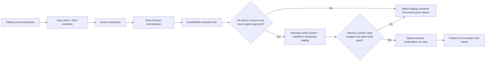

# ADR-0001 — Static pipeline, storage and controlled release

- **Status:** proposed for maintainer acceptance (revised M00-T05; no production activation)
- **Date:** 2026-10-26
- **Related roadmap:** M00-T05, M01-T07, M02–M05, M06, M09–M10
- **Companion machine-readable policy:** [`../architecture/static_pipeline_policy.json`](../architecture/static_pipeline_policy.json)

## Context and constraints

MetroLens is a bilingual, static-first data observatory. We have locally audited a CMHC workbook, a 2021 Census CSV ZIP and a Canadian Income Survey CSV ZIP. Their observations are independently reproducible, but **their statistical populations, year alignment, CMHC/Census cross-publisher geography crosswalk and publisher reuse clearance have not been approved**. None of those source files belongs in a public artifact or Git commit.

M00-T04 design was accepted by the maintainer on 2026-10-26: two **unjoined** rent and income series, paired light/dark/mobile design and two explanatory story concepts. The maintainer also requested substantially more interactive charts/maps in future milestones. This ADR makes that possible without requiring a paid server or silently broadening the approved indicator scope.

## Proposed architecture decision

**Choose local/ephemeral raw source files + manifests, offline Parquet intermediate datasets, DuckDB/dbt analytics, and *only approved versioned JSON/static geodata* for browser delivery.** Do not place raw source archives, Parquet datasets, DuckDB databases or unapproved data samples under the frontend's public directory. Nothing in this ADR grants a source redistribution licence or activates publication.

| Boundary | Storage and format | Lifecycle / allowed consumer | Main gate and milestone |
| --- | --- | --- | --- |
| Source cache / raw | Publisher-original ZIP/CSV/XLSX and SHA-256 manifests in gitignored `pipeline/data/raw/` | Locally retained for auditable discovery; future ephemeral manual ingestion runner may redownload and recheck | Source identity, URL, checksum, layout and licensing evidence (M00/M02) |
| Bronze | Immutable source-byte references and per-ingestion manifests in ignored `pipeline/data/bronze/` | Offline ingestion history, not browser data; store retrieved UTC timestamp, source version and ingestion result | No stale/partial/inconsistent source promotion (M02/M03) |
| Silver | Typed, compressed Parquet in ignored `pipeline/data/silver/`; partition by source/period only if measurements justify | Offline pandas/pyarrow + DuckDB; preserve quality flags, population, original geography codes/vintages and nullable state | Schema, DGUID/crosswalk and row-key tests (M03) |
| Gold | DuckDB/dbt reviewed metric marts, optional Parquet in ignored `pipeline/data/gold/` | Offline batch process only; data contract must describe unit, period, aggregation and method | Independent metric approval, reconciliation and licence checks (M04) |
| Release staging | Versioned, small JSON shards + signed-off manifest and *licensed* simplified geographic boundaries | Build-only staging, not public by default; browser gets only data needed for requested route/filter | Export schema, byte limits, source attribution, reviewer approval and atomic release (M04/M05) |
| Browser | Next.js `output: 'export'` routes + selectively loaded JSON, ECharts and MapLibre Client Components | No public API or app server; no raw/parquet/duckdb downloads; static host serves immutable release artifact | Verified static build, accessibility, fallback and manual deployment (M05/M06/M09) |

### Storage ownership and retention

1. **MVP raw choice:** keep original publisher bytes in the existing ignored local probe directories, not Git, Pages or `frontend/public`. Retain the source URL, digest and structural inspection manifest. If a future clean runner cannot access source bytes and cannot legally re-fetch/reproduce them, **fail the run** rather than substitute guessed data. GitHub Actions runners do not persist a local cache between jobs.
2. **No mandatory object store:** paid S3, managed databases and always-on storage services are not required for the MVP. Any future durable raw archive (e.g. object storage with access controls/retention) requires a separate cost, permission, privacy and licensing decision. Short-lived workflow artifacts are for diagnostics only, never the canonical archive.
3. **Parquet only from M03:** build Bronze/Silver/Gold steps after M02 source adapters; Parquet plus pyarrow/DuckDB is a local analytical format, not a browser transport. Start with one manageable canonical dataset rather than premature region/year shard explosion. Pin tool versions and schema in M01/M03; do not assume dependencies exist during M00.
4. **Data freshness and revision:** retain original `reference_period`, separate official `published_at` when known, UTC `retrieved_at`/`generated_at`, source revision and SHA-256. A new publisher release or definition change must create a new validated dataset version and may require new ADR/compatibility review. Never overwrite a last-known-good release with a failed ingestion.
5. **Licensing:** preserve publisher notices and links; public derivative/export is blocked if reuse or attribution has not been independently cleared. A matching StatsCan DGUID does not validate the CMHC geography mapping.

### Proposed publish manifest and file contract (not yet an implemented schema)

M04 must formalize and validate a release manifest with at least `schema_version`, `dataset_version`, `generated_at` UTC, `source_revisions` (publisher URL, SHA-256, period, retrieval date), `metric_contracts` (unit, measure type, population, period and review status), and per-file `path`, `sha256` and `bytes`. Each approved JSON observation must preserve missing/suppressed states; **no missing value is silently converted to zero**. Use stable sorted keys and deterministic row ordering so the same inputs/transform version produce reproducible outputs; distinguish run timestamp metadata from content identity. Export only approved fields and route-specific shards after a release gate checks licence, source quality, compatibility and reviewer acceptance.

Proposed route asset layout (names subject to final M04 contract):

```text
pipeline/data/raw/                 # ignored, locally verified publisher bytes
pipeline/data/bronze/              # ignored, immutable ingestion references/manifests
pipeline/data/silver/              # ignored, typed Parquet
pipeline/data/gold/                # ignored, reviewed DuckDB/dbt/Parquet marts
staging/approved-release/          # generated temporary directory, NOT currently enabled
  data/data-manifest.json
  data/cities/vancouver_cma_2021.json
  data/geo/cma-2021.topo.json
frontend/public/data/              # populated ONLY by an approved future M04/M05 release step
frontend/out/                      # static Next.js export; manually deployed from main
```

The first four directories are not committed. `staging/approved-release/` is conceptual and **must not be created or published automatically by this ADR**. No actual data are authorized for copying into `frontend/public/data/` yet.

### Quality gate and atomic release



Generation and validation must finish in a separate staging directory before any release artifact is considered publishable; prefer switching an entire versioned release artifact over copying individual files in place. Missing source, failed checksum, suppressed metric, inconsistent geography or unapproved source reuse blocks promotion. Preserve the previous good published artifact for rollback. **M00 only documents this design; M04/M09 must implement and test the enforcement.**

### Runtime, interactivity, and cost boundary

- The M05 Next.js App Router product uses `output: 'export'`, `trailingSlash: true`, static EN/PT-BR routes and a tested `basePath` for project-site Pages. **No SSR per request, API endpoint, middleware, Server Actions, ISR or live backend dependency** in this contract. Client-side filters and selected charts may be interactive despite static hosting.
- M05: load ECharts components on demand for source-specific rent/income series, provide keyboard/focus detail and equivalent tables. M06: MapLibre GL JS, simplified and appropriately licensed CMA boundaries, region select/zoom/pan, linked chart filters and URL state. M08: interactive story visuals with provenance and methodology. **Never paint unapproved values onto a CMA boundary or imply that mean rent divided by median economic-family income is a household rent burden.**
- Prefer static self-hosted geometry and backgrounds which work without billable/geocoding/map-tile APIs; external tile providers require terms and quota review. Lazy-load map/charts only on routes that need them, provide non-WebGL and no-JS alternatives, and verify keyboard, reduced motion, color-blind differentiation and EN/PT-BR labels.
- **Release control unchanged:** existing `.github/workflows/verify.yml` and `pages.yml` remain `workflow_dispatch` only. There are no push/PR/cron triggers. Pages must run on `main` with explicit `confirm_release: true` and all gates passing. Scheduled refresh is deferred to M09 and a separate ADR; do not introduce automation or change repository host settings in M00.
- Cloudflare Pages and other static hosts remain *optional future alternatives*. A hosting migration needs its own cost/operational review; this ADR neither deploys nor implies Cloudflare is already configured.

## Alternatives and trade-offs

| Alternative | Choice / reason |
| --- | --- |
| Commit publisher files and Parquet to Git | **Reject.** Repository bloat, stale provenance and potential reuse violations; commit source metadata and tests instead. |
| Deploy Parquet/SQLite/DuckDB directly to browser | **Reject for MVP.** Unnecessary transfer, resource cost and risk of exposing unreviewed records. Browser receives purpose-built JSON. |
| Store all raw inputs in a cloud object store now | **Defer.** Adds cost and administration before there is a verified durability need. May be revisited under explicit policy. |
| Build live database-backed application | **Reject for static MVP.** Server operations and publication complexity without demonstrated need. |
| Publish on every push or automatically schedule ETL | **Reject through M08.** More runs and risk of partial publication; manual gates retained until M09 review. |
| Avoid rich visuals because the site is static | **Reject.** Client components can render ECharts and MapLibre over versioned static shards without an always-on server. |

## Review and decision record

**Awaiting maintainer acceptance of this revised ADR-0001** (M00-T05). The user previously accepted the M00-T04 visual/scope/story direction, **not** this architectural choice. This ADR is therefore proposed, and no pipeline storage, Parquet transformation, publication, Cloudflare migration, auto-deploy or cron behavior is activated by this change. M00-T06 naming/identity and the unrelated source licences/geography/statistical compatibility gates still need resolution before M00 completion.
